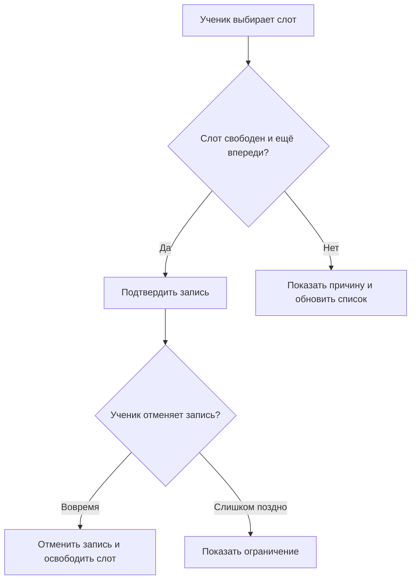

# Запись на индивидуальное занятие

Ученик выбирает свободное время. Преподавателю важно избежать двойного бронирования. Для первой версии расписание уже загружено, а оплата, уведомления и перенос одним действием остаются за рамками кейса.

**Роли.** Ученик бронирует и отменяет свои записи. Преподаватель проводит занятия и отмечает итог. Сервер хранит время в UTC. Пользователь видит время в своём часовом поясе.

| ID | Правило | Критерий приёмки |
| --- | --- | --- |
| R1 | Записаться можно на существующий свободный слот строго до его начала | Если слот начинается ровно сейчас, сервер отклоняет запись |
| R2 | На слот может приходиться только одна подтверждённая запись | При двух одновременных запросах от разных учеников один создаёт запись, второй получает конфликт |
| R3 | Ученик может отменить свою подтверждённую запись не позднее чем за 2 часа | При остатке ровно 2 часа отмена проходит и слот сразу освобождается. При остатке 1 час 59 минут сервер отклоняет запрос |
| R4 | Повтор бронирования с тем же ключом и параметрами возвращает результат первой успешной операции | После сетевого таймаута повтор возвращает тот же идентификатор и не создаёт вторую запись |
| R5 | После окончания занятия преподаватель может отметить, что занятие состоялось или ученик не пришёл | До окончания занятия и для отменённой записи операция отклоняется |

**Жизненный цикл.** Создание сразу даёт статус `CONFIRMED`. Из него запись может перейти в `CANCELLED`, `COMPLETED` или `NO_SHOW`. Эти три статуса конечные. Действие преподавателя описано в требованиях, а REST-контракт охватывает бронирование и отмену учеником.

**Вопрос для согласования.** Что делать с поздней отменой по уважительной причине? Для первой версии обработка исключений не предусмотрена. В метриках такие занятия попадут в `NO_SHOW`, если преподаватель зафиксирует неявку.
